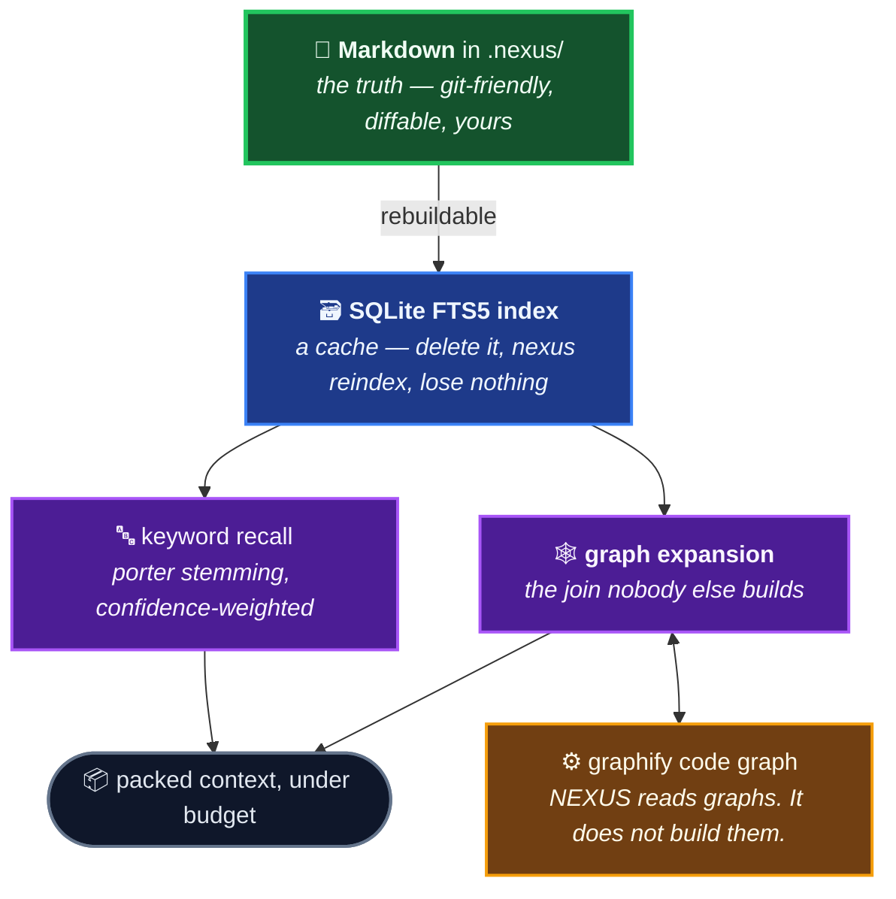

<div align="center">

# ✦ NEXUS

### Engineering Intelligence & Memory System

**Your codebase remembers. Your agent stops re-learning it every session.**

[](LICENSE)
[](pyproject.toml)
[](#-development)
[](#-privacy)
[](#-use-it-from-your-agent)

<br>

```
nexus · mem 42 · graph 628 · full:developer,security · saved~28,045 · 3 dirty
```

<sub>↑ what sits under your chat input once it is installed</sub>

</div>

---

## 🔴 The problem

Every coding session starts from zero. The agent re-reads the same files, re-derives the same constraints, and re-makes a decision the team already made six months ago — because nothing carried over. Meanwhile it edits a file without knowing that four other modules depend on it, and reports "tests pass" without having run them.

NEXUS fixes the three gaps underneath that:

| | Gap | What NEXUS adds |
|:--:|---|---|
| 🧠 | **The session forgets** | Durable, confidence-graded project memory in Markdown, retrieved by keyword **and** by graph traversal |
| 💥 | **The agent edits blind** | Blast-radius analysis across parsed imports, text, tests and (optionally) a language server |
| 🧾 | **Claims are not evidence** | A gate that runs the checks and **cannot record a pass it did not observe** |

It is local-first. No model is called, no network is touched, nothing leaves the machine.

## 📦 Install

**As an agent skill** (skills.sh — works in Claude Code, Cursor, Codex and ~60 other agent dirs):

```bash
npx skills add jainrakshit24/Nexus
```

**As a Claude Code plugin:**

```
/plugin marketplace add jainrakshit24/Nexus
/plugin install nexus@nexus
```

**As a CLI** (the skill bootstraps this for you, or do it yourself):

```bash
pip install "nexus-eims @ git+https://github.com/jainrakshit24/Nexus.git"
```

## ⚡ Quick start

```bash
cd <your repo>
nexus init .                      # detect stack + test command, create .nexus/

nexus recall "auth token"         # what do we already know?
nexus plan src/billing.py         # before editing: dependents, risks, owning role, missing ADR
nexus verify                      # after editing: diff, secrets, lint, types, vulns, API breaks, tests
nexus remember "webhooks are idempotent via event.id" \
  --confidence verified --source src/billing/webhooks.py:88
```

That loop — *recall → plan → edit → verify → remember* — is the whole product. Everything else is support.

<details>
<summary><b>Full command surface</b></summary>

```bash
# memory
nexus remember "..." --confidence verified --source file.py:12
nexus recall <query> --limit 5     nexus show <name>      nexus forget <name>
nexus consolidate                  # fold old episodes into monthly summaries
nexus reindex                      # rebuild the index from Markdown (truth is on disk)
nexus status

# understanding
nexus impact src/billing.py --depth 2       # transitive dependents
nexus impact src/billing.py --serena        # language-server precision, ~4.7s
nexus context "add proration" --budget 4000 # a packed brief, under a hard token budget
nexus tokens                                # measured actual / measured baseline / estimated saved
nexus graph                                 # graph size and staleness, no rebuild

# discipline
nexus plan <file>        nexus verify [--staged]
nexus adr new "Title" --affects src/billing.py      nexus adr list
nexus debt add "..." --where src/billing.py:40      nexus debt list
nexus env --write                           # .env.example from key names only, never values

# surfaces
nexus serve              # MCP server over stdio
nexus install claude-code | codex | cursor | vscode | all [--dry-run]
nexus dashboard [--compact]
```

</details>

---

## 🔄 How to use it — the process

The loop is five steps. Four of them are one command each, and the fifth is the one everybody skips.

```mermaid
flowchart LR
    S([New task]) --> R["🧠 1 · RECALL<br/><code>nexus recall</code>"]
    R --> P["💥 2 · PLAN<br/><code>nexus plan</code>"]
    P --> C["📦 3 · CONTEXT<br/><code>nexus context</code>"]
    C --> E["✍️ 4 · EDIT<br/>you or the agent"]
    E --> V["🧾 5 · VERIFY<br/><code>nexus verify</code>"]
    V -->|BLOCKED| E
    V -->|PASSED| M["💾 6 · REMEMBER<br/><code>nexus remember</code>"]
    M --> S

    classDef recall  fill:#1e3a8a,stroke:#3b82f6,stroke-width:2px,color:#eff6ff
    classDef plan    fill:#713f12,stroke:#f59e0b,stroke-width:2px,color:#fffbeb
    classDef ctx     fill:#4c1d95,stroke:#a855f7,stroke-width:2px,color:#faf5ff
    classDef edit    fill:#1f2937,stroke:#6b7280,stroke-width:2px,color:#f9fafb
    classDef verify  fill:#7f1d1d,stroke:#ef4444,stroke-width:2px,color:#fef2f2
    classDef mem     fill:#14532d,stroke:#22c55e,stroke-width:2px,color:#f0fdf4
    classDef start   fill:#0f172a,stroke:#475569,stroke-width:2px,color:#e2e8f0

    class R recall
    class P plan
    class C ctx
    class E edit
    class V verify
    class M mem
    class S start
```



### Step 0 · Set it up, once per repository

```bash
cd <your repo>
nexus init .
```

Detects your stack, finds your test command, creates `.nexus/`. Then point your agent at it:

```bash
nexus install claude-code          # or codex / cursor / vscode / all
nexus install all --dry-run        # see exactly what it would write first
```

> 💡 Optional but worth it: run `/graphify .` in your agent once. NEXUS reads the code graph it produces, which is what makes impact analysis follow imports instead of guessing from text.

---

### 🧠 Step 1 · RECALL — ask before you grep

```bash
nexus recall "auth token refresh"
```
```
[100.0] refresh-tokens-are-single-use (semantic/verified) — src/auth/session.py:142
[ 86.4] token-window-predates-mobile (project/observed) — docs/adr/0004.md
2 result(s) in 0.2 ms
```

**Why first:** a verified fact costs ~30 tokens. Rediscovering it costs a file read, a wrong turn, and sometimes a bug you already fixed once. If recall comes back empty, investigate normally — then come back at Step 6.

> ⚠️ Facts marked `observed` or `assumed` are shown with that label attached. NEXUS never promotes a guess to a fact.

---

### 💥 Step 2 · PLAN — find the blast radius before touching anything

```bash
nexus plan src/auth/session.py
```
```
dependents    7 files (graph, depth 2)
              middleware.py · api/login.py · api/refresh.py · tasks/cleanup.py (+3)
gear          full
roles         developer, security, qa
risk          HIGH — 3 open debt items touch these files
adr           none covers token lifetime → nexus adr new
```

**Read the gear.** `light` means 1 file, no dependents, no public API — just make the change. `full` means the blast radius earned a review. Routing is by **impact, not by task type**, so a one-line fix never summons three reviewers.

If an ADR is required and missing, the plan is `BLOCKED`. Write it, then re-plan:
```bash
nexus adr new "Shorten refresh token lifetime" --affects src/auth/session.py
```

---

### 📦 Step 3 · CONTEXT — pack a brief instead of reading files whole

```bash
nexus context "shorten refresh token lifetime" --budget 4000
```
```
actual   (measured)  :      916 tokens   [tiktoken/cl100k_base]
baseline (measured)  :    9,122 tokens   [full-file reads of the same files]
saved    (estimated) :    8,206 tokens   [baseline − actual; the baseline was never run]
```

This is the token lever. It assembles the relevant memory, the impact set and the symbol outlines under a **hard budget** — instead of the agent reading four files to find four lines.

> ℹ️ On tiny files the pack costs more than the files do, because it also carries memory and impact. NEXUS reports **zero saved** in that case rather than a negative number.

---

### ✍️ Step 4 · EDIT

Your job, or your agent's. NEXUS does not write code — it never has an LLM loop, and adding one requires an ADR.

---

### 🧾 Step 5 · VERIFY — evidence, not assertions

```bash
nexus verify              # whole working tree
nexus verify --staged     # just what you are about to commit
```
```
## Tests
`pytest` PASSED in 8.77s   (291 passed)

## Static checks
- lint: `ruff check .` PASSED
- types: NOT RUN — no types tool is configured for this project
- vulnerabilities: NOT RUN — pip-audit is configured but is not installed
                   — this is a broken setup, not a pass

## Changes
- api shape: 1 BREAKING — rotate_token() lost required arg `grace`

VERDICT: BLOCKED — breaking change without an ADR
```

Three states, never two: **pass**, **fail**, and **not configured**. "Configured but not installed" is reported as a broken setup, never quietly as a pass. And a passing result **cannot be constructed without the captured output that proves it** — see [the invariant](#-the-honesty-invariant).

Wire it to git so it cannot be skipped:
```bash
nexus install git-hooks     # pre-commit runs `nexus verify --staged`
```

---

### 💾 Step 6 · REMEMBER — the step everyone skips

```bash
nexus remember "refresh tokens are single-use; reuse revokes the whole family" \
  --confidence verified \
  --source src/auth/session.py:142
```

| Flag | Use it for |
|---|---|
| `--confidence verified` | You saw it in the code, or a test proved it |
| `--confidence observed` | You saw the behaviour, but not the line that causes it |
| `--confidence assumed` | A working assumption — stored, labelled, never presented as fact |
| `--source file.py:line` | **Always pass this when you have it** |

`--source` does two jobs beyond citation: it **anchors** the fact to that file, so the graph can reach it later even when the wording does not match — and it marks the fact **stale the moment that file's content changes**, so a fact can never quietly outlive the code it described.

**Write a fact when it would have saved you the last ten minutes.** Not a diary — a decision, a non-obvious constraint, a gotcha, a why.

Related:
```bash
nexus adr new "Title" --affects src/billing.py    # a decision, with its reasoning
nexus debt add "retry loop has no ceiling" --where src/billing.py:140
nexus consolidate                                  # fold old episodes into monthly summaries
```

---

### 📺 Where the numbers show up

You do not have to run `nexus tokens` to see what you saved. After `nexus install claude-code` it appears in three places on its own:

| Where | What you see | When |
|---|---|---|
| **Status line**, under the chat input | `nexus · mem 42 · graph 628 · full:developer,security · saved~28,045 · 3 dirty` | continuously |
| **In the conversation**, at session start | `Context packing: 28,045 tokens saved (estimated) over 9 pack(s)` | every new session |
| **In the conversation**, after any context pack | the full actual / baseline / saved breakdown | every `nexus_context` call |

```bash
nexus dashboard            # the full page, 127.0.0.1 only
nexus dashboard --compact  # the one-liner, by hand
nexus tokens               # the breakdown, plus host-reported usage
```

> 🔒 The dashboard reads `.nexus/` straight off disk and is **unreachable from the MCP server**, so watching it costs the agent zero context tokens. That is enforced by a test, not by a promise.

> ⚠️ Claude Code allows one status line. If you already have one configured, installing NEXUS at project scope takes it over inside this repository. Run `nexus install claude-code --dry-run` first to see exactly what changes.

---

## 🏗️ How it works



| | |
|---|---|
| 🟢 **Green** | the truth. Plain Markdown you can read, grep, diff and commit. |
| 🔵 **Blue** | a cache. Nothing lives here that cannot be rebuilt from green. |
| 🟣 **Purple** | the two retrieval paths — and they run **together**, not either/or. |
| 🟠 **Orange** | an external engine NEXUS reads and never reimplements. |

**The join is the point.** Keyword search answers "what did we say about auth". Graph expansion answers "what do we know about the code this file depends on" — a question with no shared vocabulary at all. A fact anchored with `--source` becomes reachable through the import graph, and goes stale automatically when that file's content changes.

NEXUS is deliberately **wiring, not engine-building**. The code graph, the language server and the host orchestration already exist as mature tools. NEXUS adds the thin layer they were all missing. See [`docs/adr/0001-reuse-over-build.md`](docs/adr/0001-reuse-over-build.md).

## 📊 Measured

Every number below came from a command in this repository. Full method and caveats in [`docs/BENCHMARK.md`](docs/BENCHMARK.md).

**Context packing** — `nexus context`, counted with `cl100k_base`:

| Task | packed | reading those files whole | ratio |
|---|---|---|---|
| refactor a record module | 916 | 9,122 | **0.10** |
| add a CLI flag | 506 | 4,747 | **0.11** |
| speed up retrieval | 940 | 10,024 | **0.09** |

**Retrieval** — 50 questions that deliberately paraphrase their facts instead of quoting them:

| | recall@1 | recall@5 |
|---|---|---|
| keyword only | 0.54 | 0.70 |

And on questions only the graph can answer (asked by naming a *caller*, a symbol present in no fact):

| | recall@5 |
|---|---|
| keyword only | 0.00 |
| keyword **+ graph expansion** | **1.00** |

**Impact vs. grep**, same target: grep found 4 files, `nexus impact --depth 2` found 7 — including three transitive dependents that never contain the string at all — and correctly dropped grep's one false positive, a match inside a comment.

**Cold start on 10,101 files:** discovery 101 ms, MCP launch→initialize 44 ms, impact without a graph 318 ms.

## 🤖 Use it from your agent

```bash
nexus install claude-code     # or codex / cursor / vscode / all
```

Points the host at `nexus serve`, an MCP server exposing five tools:

`nexus_recall` · `nexus_remember` · `nexus_impact` · `nexus_context` · `nexus_gate`

Host support — tested and untested, stated separately — is in [`docs/COMPATIBILITY.md`](docs/COMPATIBILITY.md).

`nexus install claude-code` also registers a **status line under the chat input**, so the savings are visible where you are actually working:

```
nexus · mem 4 (3 stale) · graph 628 STALE · full:developer,security,qa · saved~28,045 · 3 dirty
```

Live memory count, graph size and freshness, the active plan and its roles, estimated tokens saved, and dirty files. The session-start hook reports the same running total in the conversation itself. There is no panel *inside* the chat — no host supports injecting one, and NEXUS does not pretend otherwise.

The full dashboard (`nexus dashboard`, bound to 127.0.0.1) is deliberately **not** reachable from the MCP server, so watching NEXUS costs the agent zero context tokens. That is enforced by a test, not by a promise.

## 🔒 The honesty invariant

One rule runs through the whole gate: **a pass with no captured evidence is not a pass.**

```python
if self.exit_code == 0 and not self.log.strip():
    raise ValueError("refusing to record a passing check with no captured output")
```

It is impossible to construct a passing result without the output that proves it. "Configured but not installed" is reported as a broken setup, never silently as a pass. NEXUS reads the project's own lint, type and audit configuration and never installs a tool behind your back.

## 🛡️ Privacy

- No model calls, no telemetry, no network.
- Secrets are read at point of use from the OS keychain (`secret-tool` / `pass` / `security`). An AST-level test asserts NEXUS calls no writer, so it cannot persist a credential even by accident.
- `nexus env --write` emits key *names* only — never values.
- The diff scanner reads untracked files whole, because `git diff` does not show a brand-new file containing a hardcoded key.
- Findings allowed by `.nexus/secret-allowlist` are still printed, never hidden. A scanner that silently suppresses is a scanner nobody trusts.

## ⚠️ Known limits

Stated up front, because a tool that hides these is worse than one that has them.

- **Memory from a repository you did not write is untrusted input.** `.nexus/` is Markdown and travels with the repo — that is the feature — so cloning a project means its memory enters your agent's context at session start. NEXUS fences that block and labels it `untrusted`, but a host that ignores the label is still reading someone else's words. Read `.nexus/` before running an agent in a repository you do not trust, the same way you would read its `Makefile`.
- **Breaking-change detection parses Python only.** Other languages get the diff and the tests, not an API shape diff.
- **Graph staleness is by mtime, not content hash** — a touched-but-unchanged file reads as stale. False-stale is the safe direction.
- **Dead-code detection counts text occurrences**, so it is blind to dynamic access (`getattr`, registries, string dispatch). Treat a hit as a question, not a verdict.
- **`--serena` costs ~4.7 s on a cold call.** Repeat queries against an unchanged repository are served from a per-project cache in 14 ms, but the first one still pays the language server's start-up. That is why it is a flag, not the default.
- **Every benchmark here is synthetic and self-authored.** The same author wrote the corpus, the questions and the scoring. That is weak evidence by construction — treat the numbers as a floor and a direction.
- **NEXUS has not been run against a large third-party codebase**, only against itself and against fixtures.
- **Local embeddings were considered and declined** at recall@5 = 0.70 against a pre-registered trigger of "below 0.70". The threshold was set before the data and was not moved afterwards. Reopening conditions are in [`docs/adr/0002`](docs/adr/).

## 📚 Documentation

| | |
|---|---|
| [`docs/BLUEPRINT.md`](docs/BLUEPRINT.md) | Architecture, memory lifecycle, storage, security, token strategy |
| [`docs/BENCHMARK.md`](docs/BENCHMARK.md) | Every measurement, with the command that produced it |
| [`docs/COMPATIBILITY.md`](docs/COMPATIBILITY.md) | Host support, tested vs. untested |
| [`docs/RESEARCH.md`](docs/RESEARCH.md) | What already existed, licenses, reuse-vs-build |
| [`docs/PHASES.md`](docs/PHASES.md) | The build plan and its acceptance criteria |
| [`docs/PHASE1.md`](docs/PHASE1.md) … [`PHASE6.md`](docs/PHASE6.md) | What each phase shipped, and what it failed at first |
| [`docs/adr/`](docs/adr/) | Architecture decision records |

## 🗂️ Repository structure

```
nexus/                     the Python package — everything the tool does
├── store.py               memory: Markdown truth + SQLite FTS5 cache
├── record.py  scrub.py    one fact per file; secrets never reach disk
├── graph.py   symbols.py  graphify adapter, AST outlines
├── impact.py  context.py  blast radius, budgeted context packing
├── gate.py    evidence.py pre/post-edit gates, the no-pass-without-proof rule
├── checks.py  apishape.py lint/types/vulns, breaking-change detection
├── migrations.py secrets.py  destructive-SQL detection, read-at-use keychain
├── roles.py   adr.py      routing by blast radius, decision records
├── server.py  mcpclient.py  MCP stdio server and client
├── adapters.py hooks.py   host wiring, session hooks
├── dashboard.py tokens.py local page, honest token accounting
└── cli.py                 the command surface

skills/nexus/SKILL.md      the agent skill (skills.sh + Claude Code both read this)
.claude-plugin/            plugin + marketplace manifests
tests/                     316 tests, including a security regression suite
bench/                     the benchmarks behind every number in the README
docs/                      blueprint, phase logs, measurements, ADRs
```

**The landing page lives on the [`site`](../../tree/site) branch, not here.** It is a
marketing surface: nothing in `nexus/` imports it, the test suite does not run it,
and `pyproject.toml` does not ship it. Keeping it off `main` means a clone of this
branch is the tool and only the tool — no Node toolchain, no 500-package lockfile,
no build step between you and `pip install`.

```bash
git switch site     # the page, its own stack, its own README
```

It stays in the same repository rather than a separate one so the page and the
benchmarks it quotes share one `docs/` directory and can be changed together.

## 🔧 Development

```bash
pip install -e ".[dev]" --no-build-isolation
python3 -m pytest tests -q      # 291 tests
ruff check .
nexus verify                    # NEXUS gates itself
```

## 📄 License

MIT — see [LICENSE](LICENSE).
