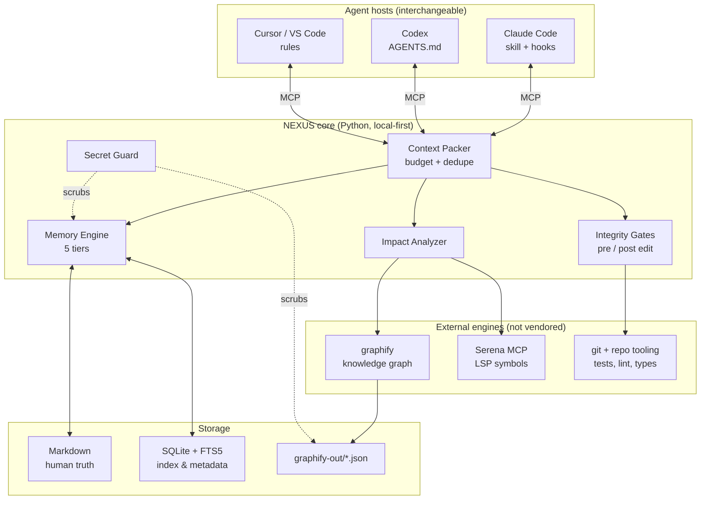
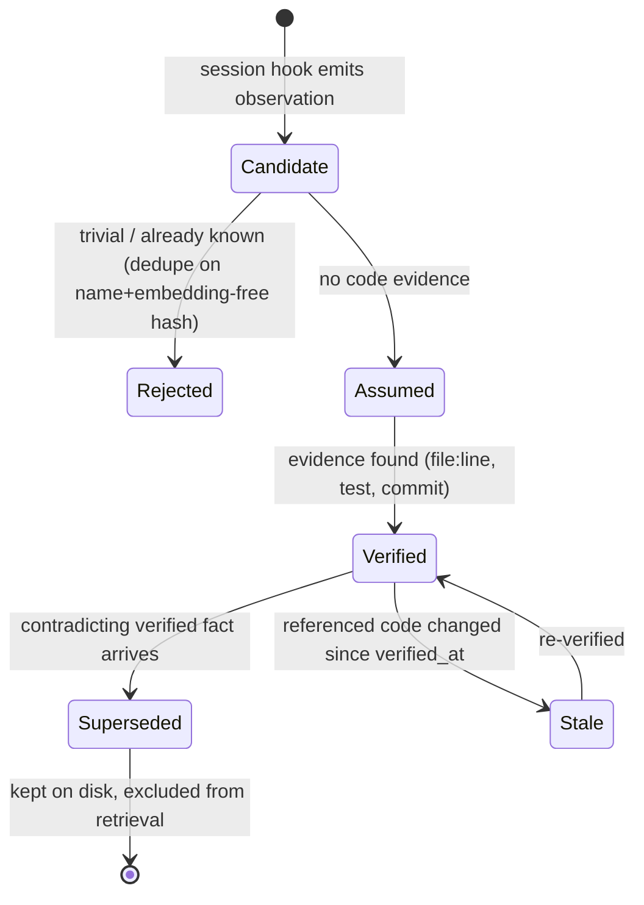

# NEXUS — Technical Blueprint

## 1. Scope (and what is deliberately out)

**In:** durable project memory, a code knowledge graph joined to that memory,
impact analysis before edits, engineering gates after edits, relevance-based
context packing with measured token accounting, and portability across
Claude Code / Codex / Cursor.

**Out (v1):** NEXUS does not run an LLM loop, does not host models, does not own
the agent runtime, does not auto-edit code. The host agent does those. NEXUS is a
**context + verification service** that agent talks to.

> This single boundary is what keeps NEXUS cross-platform. Every system that broke
> this rule (Letta, LangGraph) became a runtime you must migrate *into*.

## 2. Architecture



**One integration surface:** NEXUS exposes an MCP stdio server. Claude Code, Codex
and Cursor all speak MCP, so each adapter is a few lines of config plus a
platform-native instruction file — not a port.

## 3. Memory architecture

Five tiers, one store, one index.

| Tier | Holds | Lifetime | File |
|---|---|---|---|
| Global | user prefs, conventions | permanent | `~/.nexus/global/*.md` |
| Project | stack, architecture, APIs, schema, known bugs | permanent, versioned | `<repo>/.nexus/project/*.md` |
| Episodic | what happened in a session, failures, debug traces | decays, summarised at 30d | `<repo>/.nexus/episodes/YYYY-MM/*.md` |
| Semantic | reusable facts + relations, graph-linked | permanent, confidence-scored | `<repo>/.nexus/semantic/*.md` |
| Procedural | build, deploy, test, run-this-project | permanent | `<repo>/.nexus/procedures/*.md` |

**Record format** — reuses the convention already on this machine (one fact per file,
frontmatter + `[[wikilink]]`), extended with the fields the brief requires:

```yaml
---
id: mem_01J...            # ULID, stable across edits
name: auth-token-refresh-is-server-side
type: project             # global|project|episodic|semantic|procedural
confidence: verified      # verified | observed | assumed
source: "src/auth/refresh.ts:L40 + commit a1b2c3d"
verified_at: 2026-11-16
supersedes: mem_01H...    # old record kept, marked superseded — never deleted
graph_refs: ["fn:refreshToken", "file:src/auth/refresh.ts"]
---
```

**Lifecycle**



Three rules that make this trustworthy:
1. **Nothing enters as `verified` without a source pointer.** Assumptions are stored as `assumed` and retrieved with that label attached.
2. **Conflicts supersede, never overwrite.** History is the point.
3. **Capture is hook-driven, not conversation-driven.** We record *verified outcomes* (a test went green, a schema changed, a decision was made), not chat.

## 4. Knowledge graph

graphify owns extraction. NEXUS owns three things it doesn't do:

- **Join:** `graph_refs` in memory ↔ node ids in `graphify-out/graph.json`.
- **Staleness:** store the commit SHA the graph was built at; any node whose file changed since is `stale` and retrieval says so out loud.
- **Impact:** `nexus impact <path|symbol>` = graphify reverse edges ∪ Serena `find_referencing_symbols` ∪ test files touching either. Union, because each alone has blind spots (graphify misses dynamic dispatch; Serena misses non-code refs like SQL and config).

## 5. Storage decision

**Markdown + SQLite. No vector DB in v1.**

- Markdown = the durable, portable, human-auditable truth; moves between machines and agents with `git`.
- SQLite + FTS5 = index only (name, tags, type, confidence, graph_refs, timestamps). Rebuildable from Markdown at any time — so the DB is a cache, never the source.
- Retrieval = FTS5 keyword match **+ graph expansion** from the files in scope. For a codebase, "what touches this file" beats semantic similarity, and it costs no embedding model, no service, no API key.
- *Upgrade trigger, written down now so it isn't vibes later:* if recall@5 on a 50-question benchmark drops below 0.7, add local embeddings (`sqlite-vec` + a small local model) — not a hosted vector DB.

## 6. Orchestration

No custom agent framework. Roles are **prompt contracts** invoked as subagents by the host.

| Role | Invoked when | Backed by |
|---|---|---|
| Architect | new module, pattern change, ADR needed | `ecc:architect` / `gsd` planners |
| Developer | ordinary change | host agent itself |
| TPM | multi-step work, scope unclear | `gsd-plan-phase` |
| QA | anything touching logic or data | `ecc:*-reviewer`, repo test runner |
| DevOps | build/deploy/config files touched | `ecc:deployment-patterns` |
| Security | auth, secrets, input handling, deps | `ecc:security-reviewer` |

**Routing is by blast radius, not by task type.** NEXUS computes impact first; a
1-file/0-dependent change gets the Developer only. The brief's warning against
"excessive agent delegation" is enforced here, mechanically.

## 7. Workflow

```
DISCOVER → UNDERSTAND → ANALYZE → DESIGN → PLAN → REVIEW → EXECUTE → TEST → DOCUMENT → REMEMBER
```

Two gears, selected by impact score:

- **Light** (impact < 3 dependents, no public API, no schema): UNDERSTAND → EXECUTE → TEST → REMEMBER.
- **Full**: all ten, with ADR required at DESIGN and a human checkpoint at REVIEW.

## 8. Security

- **Secrets never enter memory or graph.** Scrub runs *before* write, on every record and every graph node, using the regex corpus already shipped in `ecc:opensource-sanitizer` (20+ patterns) plus repo `.gitignore`/`.env` awareness.
- `.env.example` generation: keys only, values replaced with `<placeholder>`.
- Env var validation: declared-vs-present diff per environment; missing vars reported, never invented.
- Secret *values* are read from OS keychain / local store at use time and never persisted by NEXUS.
- Logs mask anything matching the corpus before writing.
- NEXUS never writes to production config. Environment is an explicit flag, default `dev`.

## 9. Token accounting — the honest version

Three numbers, clearly labelled, never conflated:

| Number | How obtained | Honesty label |
|---|---|---|
| **Actual usage** | parsed from the host's own transcript/usage records | *measured* |
| **Baseline** | tokens a naive run *would* have used = sum of full file reads the agent requested, counted by the real tokenizer | *measured counterfactual* |
| **Saved** | baseline − actual | *estimated* — always rendered with that word |

Nothing is reported as "saved" that wasn't computed from two real token counts.
If the host exposes no usage data, the dashboard shows `usage: unavailable` — not a guess.

## 10. Dashboard

- **Pane:** reuse `claude-hud` (installed) for the compact mode — tokens, memory count, graph status, active role. No browser DOM injection; that isn't a supported surface and the brief already flags it.
- **Detailed:** a localhost page served by the NEXUS CLI, auto-opened on demand, reading the same SQLite index. Local file only, per standing preference — nothing published.
- Dashboard reads state from disk. It never occupies the agent's context window.

## 11. Technology stack

| Layer | Choice | Why |
|---|---|---|
| Core | Python 3.10+ | graphify, tree-sitter, Serena are all Python; already on this machine |
| Storage | Markdown + SQLite FTS5 (stdlib) | zero deps, portable, auditable, rebuildable |
| Transport | MCP stdio | one server, every client |
| Graph | graphify (external CLI/MCP) | installed, incremental, no rebuild of a graph engine |
| Symbols | Serena (external MCP) | LSP correctness beats regex |
| Tests | pytest | stdlib-adjacent, already conventional here |
| Dashboard | stdlib `http.server` + one static page | no build step, no framework |

## 12. Risks

| Risk | Mitigation |
|---|---|
| Memory rots into confidently-wrong facts | confidence tiers + `verified_at` + stale detection; `assumed` never presented as fact |
| graphify output format changes | adapter module, one file, contract-tested against a fixture graph |
| Serena/uvx cold start is slow | lazy start, cache per project, degrade to graphify-only with a visible notice |
| Scope creep into "an agent framework" | §1 boundary; any PR that adds an LLM loop needs an ADR |
| Token savings become marketing | §9 labels enforced in code; `saved` is a computed field, not a constant |
| Cross-platform drift | one MCP server + one shared `.nexus/` dir; adapters hold config only, never logic |
