# NEXUS — 4-Phase Build Plan

The brief suggested 10 phases. Collapsed to 4, because phases that share a data
model should ship together or they get built twice. Each phase is independently
useful — you can stop after any one and still have something that works.

```mermaid
gantt
  dateFormat X
  axisFormat %s
  section Build
  P1 Foundation & Memory     :p1, 0, 2
  P2 Understanding & Impact  :p2, after p1, 2
  P3 Discipline & Security   :p3, after p2, 2
  P4 Surfaces & Proof        :p4, after p3, 2
```

---

## Phase 1 — Foundation & Memory
*(brief's Phase 1 + 2)*

Build the memory engine and the CLI around it. Nothing else works without this.

**Deliverables**
- `nexus` Python CLI: `init`, `remember`, `recall`, `forget`, `status`
- Project discovery: stack, entrypoints, test command, package manager, git state → `project/overview.md`
- 5-tier memory store (Markdown) + SQLite FTS5 index, rebuildable with `nexus reindex`
- Record schema with `confidence` / `source` / `verified_at` / `supersedes` / `graph_refs`
- Dedupe on write; conflict → supersede, never overwrite
- Secret scrub on every write (regex corpus), before anything touches disk

**Acceptance criteria**
1. `nexus init` on a real repo produces a project profile whose stated test command actually runs.
2. `nexus recall "<query>"` returns ranked records in **< 300 ms** on 500 records.
3. Writing a record containing an AWS key / JWT / DB URL is **blocked**, with the pattern named. Test asserts this.
4. Deleting the SQLite file and running `nexus reindex` reproduces identical recall results — proves Markdown is the source of truth.
5. A contradicting fact creates a supersede chain; the old record is still readable, and excluded from recall.
6. `pytest` green, ≥ 1 test per rule above.

**Depends on:** nothing. **Risk:** low.

---

## Phase 2 — Understanding & Impact
*(brief's Phase 3 + 6)*

Join memory to the code graph, and turn that join into context packing.

**Deliverables**
- graphify adapter: run/update, parse `graphify-out/graph.json`, record build SHA
- Serena adapter over MCP: `find_symbol`, `find_referencing_symbols`
- Stale detection: nodes whose files changed since graph SHA are flagged in every answer
- `nexus impact <path|symbol>` → dependents (graph ∪ LSP ∪ tests), with a blast-radius score
- `nexus context "<task>" --budget N` → a packed context: relevant memories + relevant file slices + impact set, deduped, under budget
- Token accounting module: measured actual, measured baseline, *estimated* saved (labels enforced by type)

**Acceptance criteria**
1. `nexus impact` on a known-hub file lists every dependent found by a manual `grep -r`, plus at least one the grep missed (a transitive or symbol-level one).
2. Context pack never exceeds `--budget`, verified by the real tokenizer, over 20 varied tasks.
3. Editing a file and re-querying surfaces a `stale` warning **without** rebuilding the graph.
4. `nexus tokens` prints the three numbers separately; the word "estimated" is present on `saved` and absent on the other two. Test asserts the labels.
5. Recall@5 measured on a hand-built 50-question benchmark; number recorded in `docs/BENCHMARK.md` whatever it is.

**Depends on:** P1. **Risk:** medium — graphify output contract is the soft spot; pin it behind one adapter with a fixture test.

---

## Phase 3 — Discipline & Security
*(brief's Phase 4 + 5 + 7)*

Make it refuse to do careless work.

**Deliverables**
- Workflow engine: light vs full gear, selected by blast-radius score from P2
- Pre-edit gate: affected files + dependencies + relevant memory + risks → a written plan
- Post-edit gate: real diff review, test execution, unintended-change detection, doc + memory update
- Role routing (Architect / QA / Security / DevOps) triggered by impact, not by keyword
- ADR system: `nexus adr new|list`, enforced when an architectural pattern changes
- Technical debt registry + architecture consistency check
- Environment & secret manager: `.env.example` generation, declared-vs-present validation, keychain read-at-use

**Acceptance criteria**
1. A deliberately breaking edit is caught by the post-edit gate, with the failing test output quoted. No pass is ever reported without a captured execution log — asserted by a test that stubs a "passing" claim with no log and expects a hard failure.
2. A 1-file, 0-dependent change runs **light** gear and invokes **no** specialist role. Asserted.
3. A schema-touching change runs **full** gear and requires an ADR before EXECUTE. Asserted.
4. `.env.example` from a real repo contains every required key and **zero** real values.
5. Gate never performs a destructive operation without explicit confirmation — tested with a mocked confirm that returns `no`.

**Depends on:** P2. **Risk:** medium — over-triggering is the failure mode; tune thresholds against real repos on this machine.

---

## Phase 4 — Surfaces & Proof
*(brief's Phase 8 + 9 + 10)*

Make it usable from every host, and prove the claims.

**Deliverables**
- NEXUS MCP server exposing: `recall`, `impact`, `context`, `remember`, `gate`
- Claude Code adapter: skill + `SessionStart` / `PostToolUse` hooks for capture
- Codex adapter: `AGENTS.md` generator + MCP config
- Cursor / VS Code adapter: rules file + MCP config
- Compact mode via `claude-hud` pane; detailed mode via localhost page (local file only)
- `docs/BENCHMARK.md`: recall quality, retrieval latency, token measurements, cold-start cost
- Cross-platform compatibility matrix with *tested* rows only

**Acceptance criteria**
1. The same `.nexus/` directory produces the same `recall` answers in Claude Code and in Codex. Demonstrated, not asserted in prose.
2. Dashboard shows live memory count, graph SHA + staleness, active role, and the three token numbers — and adds **0 tokens** to the agent's context (it reads disk, the agent never loads it).
3. Compatibility matrix marks every row `tested` or `untested`; no row claims support that wasn't run.
4. Cold start on a 10k-file repo measured and recorded, whatever the number.
5. Full `pytest` green; every earlier phase's tests still pass.

**Depends on:** P3. **Risk:** low-medium — Codex/Cursor capabilities differ; the matrix is allowed to say "not supported".

---

## Cross-phase rules

- Every phase ends with tests green and `docs/` updated. No phase is "done" otherwise.
- No phase may add an LLM loop to NEXUS. That needs an ADR and a very good reason.
- Any claim of a measured number must point at the command that produced it.
